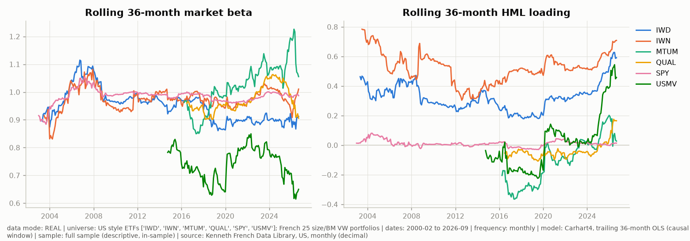
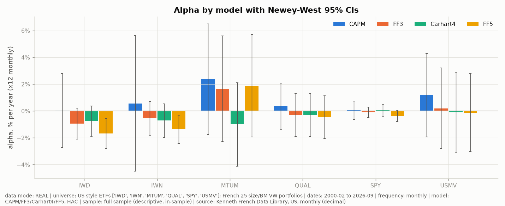
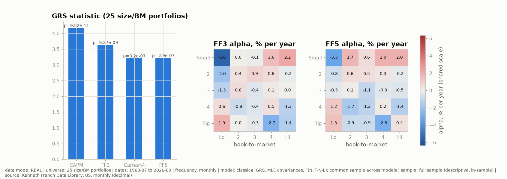
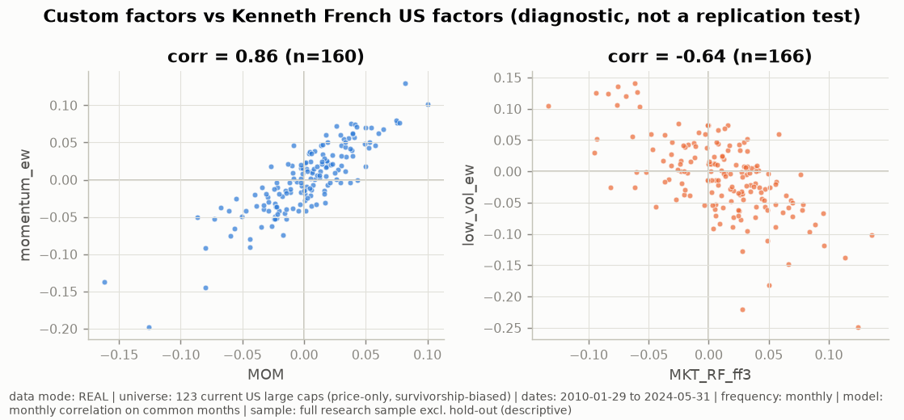
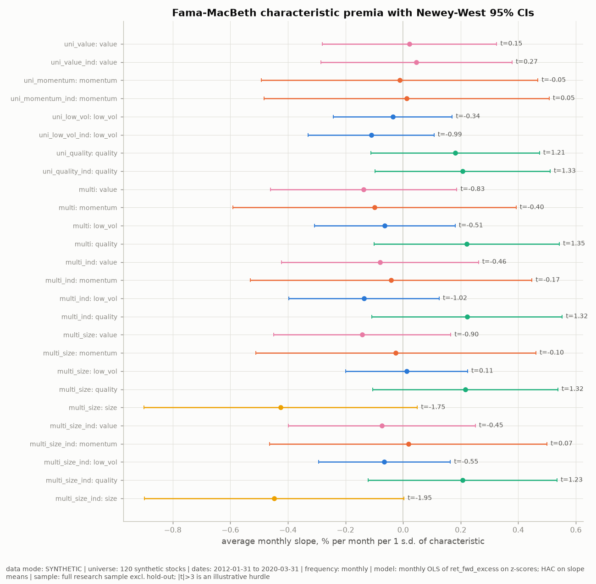
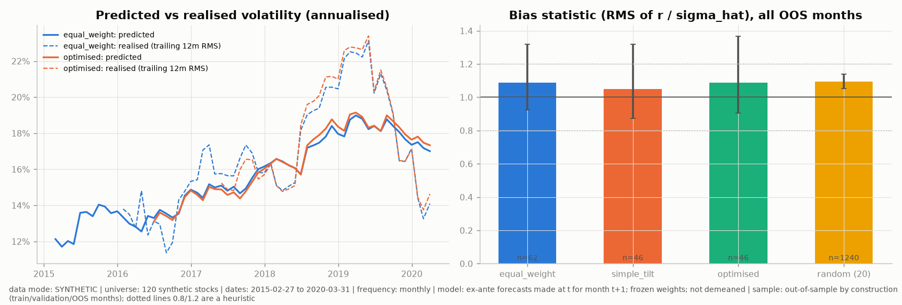
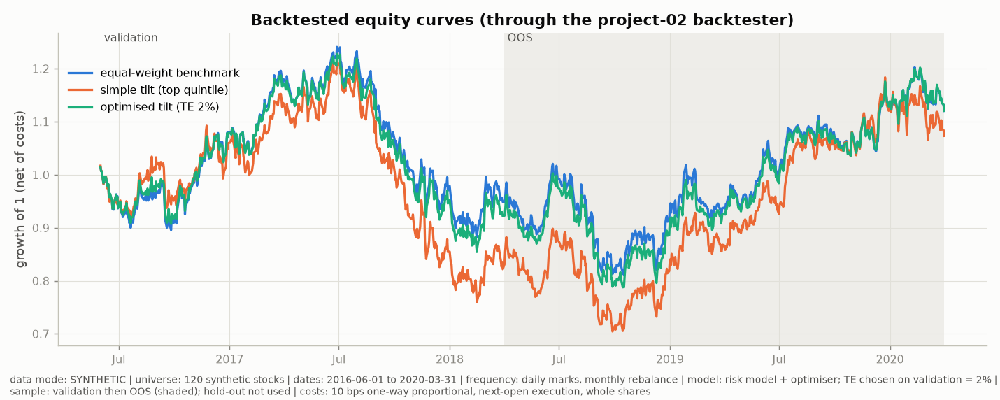
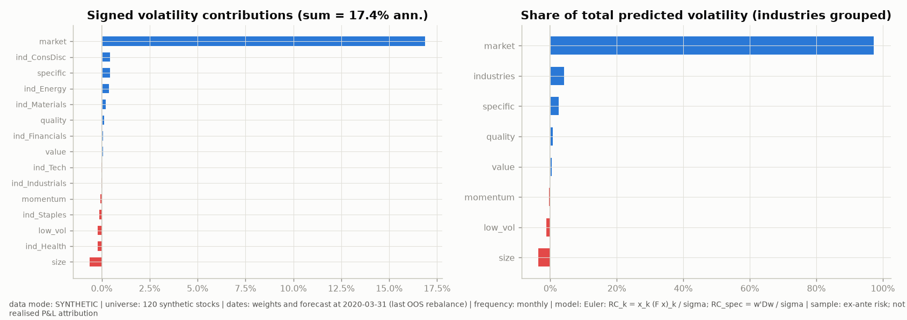
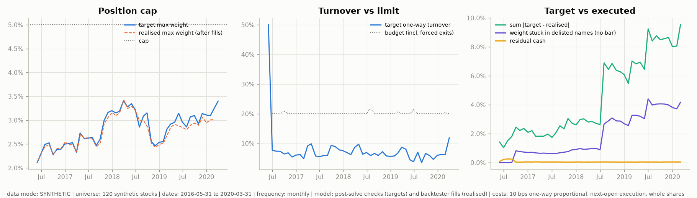

# Equity Factor Model and Risk Attribution

An educational, reproducible Python research package with three separate layers:

1. **Time-series**: explain fund and portfolio returns with CAPM, Fama–French 3/5 and
   Carhart factors (HAC inference, rolling betas, GRS).
2. **Cross-sectional**: build value, momentum, low-volatility and quality characteristics,
   form quintile portfolios and run Fama–MacBeth regressions.
3. **Portfolio risk**: a fundamental factor risk model Σ = BFB′ + D, a constrained cvxpy
   factor tilt executed through the project-02 backtester, and Euler risk attribution.

> **Educational research software.** This is not a commercial Barra or Axioma replica, not a
> production or live-trading system, and not investment advice. Results labelled
> **SYNTHETIC** come from seeded simulated data. They show that the software behaves as
> intended, not that any market edge exists. Results labelled **REAL** use public data with
> the limitations listed below.

## Status: implemented vs unfinished

| Area | Status |
|---|---|
| French data loader (FF3, FF5, momentum, 25 size/BM), unit handling, provenance | Implemented, tested (offline fakes), **executed on real data** |
| CAPM / FF3 / Carhart4 / FF5 / FF5+MOM regressions, Newey–West HAC, rolling betas | Implemented, tested, executed (synthetic + real) |
| Classical GRS (verified normalisation, edge-case checks) | Implemented, tested, executed |
| Point-in-time panel, vintage-aware as-of join of fundamentals | Implemented, tested, executed (synthetic) |
| Characteristics (value, 12-1 momentum, low-vol, quality, size), winsorise/z-score per date | Implemented, tested, executed (synthetic: all; real: momentum, low-vol) |
| Quintile sorts (EW/VW), long-short, turnover, tearsheets, factor comparisons | Implemented, tested, executed |
| Fama–MacBeth (uni/multivariate, industry controls) + linearmodels cross-check | Implemented, tested, executed |
| Risk model (WLS factor returns, two identifications, EWMA F, shrunk D) | Implemented, tested, executed (synthetic) |
| Out-of-sample risk-forecast validation (bias statistics, rolling calibration) | Implemented, tested, executed (synthetic) |
| cvxpy optimiser (cap, TE cone, turnover, exposure/industry limits, fallback) | Implemented, tested, executed (synthetic) |
| Backtester integration (project 02, public API, next-open fills, costs) | Implemented, tested, executed (synthetic) |
| Euler risk attribution (total and active), stock MCTR | Implemented, tested, executed |
| Protected hold-out (`run_holdout.py --confirm`) | Implemented, tested (refusal path); **not consumed** |
| Real value/quality research | **Not run**: no point-in-time fundamentals available (schema + loader provided) |
| Real-stock risk model / optimiser / backtest | **Not run**: no point-in-time market caps or fundamentals |
| Daily risk model, Newey–West/eigen adjustment of F, PCA model, realised-return (P&L) attribution, beta-pricing two-pass tests | **Not implemented** |

## Installation

Python 3.11 or later (built and tested on 3.13). From the project folder:

```powershell
uv venv .venv --python 3.13
```

```powershell
uv pip install --python .venv\Scripts\python.exe -e ".[dev,market,ref]"
```

Optional, needed only for the backtests: install the local project-02 backtester from your
own checkout. It is not on PyPI and is intentionally not listed as a dependency.

```powershell
uv pip install --python .venv\Scripts\python.exe <path-to-your-Backtester-folder>
```

Plain `pip` works too: `python -m pip install -e ".[dev,market,ref]"`.

## Fast offline demo (synthetic, about 30 seconds)

```powershell
.venv\Scripts\python scripts\run_all.py
```

This generates seeded synthetic data (120 stocks, 10 years) on first use, runs every stage,
writes 22 figures to `results/figures/`, the numbers to `results/tables/`, logs to
`results/logs/`, and `results/run_metadata.json`. The larger research mode (400 stocks,
20 years, about 2.5 minutes) writes to `results/research/`:

```powershell
.venv\Scripts\python scripts\run_all.py --size research
```

## Academic and stock-level real data

Downloading needs internet access. Results are cached locally and never replaced with
synthetic data on failure.

```powershell
.venv\Scripts\python scripts\download_french_data.py
```

```powershell
.venv\Scripts\python scripts\download_market_data.py
```

```powershell
.venv\Scripts\python scripts\run_all.py --mode real
```

Individual stages: `scripts/run_timeseries.py`, `run_custom_factors.py`,
`run_fama_macbeth.py` and `run_risk_model.py` (same as `run_portfolio.py`). All accept
`--mode` and `--size`. CLI: `factors run --mode synthetic --stages timeseries`.
Notebooks are built and executed from package functions with
`scripts/build_notebooks.py`.

## Tests and checks

```powershell
.venv\Scripts\python -m pytest --cov=factors
```

```powershell
.venv\Scripts\ruff check .
```

```powershell
.venv\Scripts\mypy
```

Results of this build:

* **81 passed, 0 failed, 0 skipped.** All tests are offline. They include an end-to-end run of
  a tiny project copy and backtester tests.
* Line coverage is 94% (`cli.py` omitted).
* `ruff` reports no findings and `mypy` reports no issues in 18 files.

The tests never require positive premia, significance, outperformance or a calibration range.

## Results (actually generated)

All figures carry a footer with data mode, universe, dates, frequency, model and window,
in-sample/OOS status and costs. Each figure has a CSV with the same name in `results/tables/`.

### Time series: REAL (French US factors; US style ETFs 2000–2026)




* Carhart loadings follow the funds' mandates. IWN (small value) loads SMB 0.80 and HML 0.59,
  MTUM loads MOM 0.50, and USMV has a market beta of 0.70.
* FF5 alphas (annualised, HAC 95% CI): IWD −1.7% [−2.8, −0.6], IWN −1.4% [−2.4, −0.3], and the
  others have intervals that include zero. ETF returns are net of fees.
* GRS on the 25 size/BM portfolios, 1963-07 to 2026-09 (T = 759, N = 25): CAPM 4.17, FF3 3.63,
  Carhart4 3.20, FF5 3.21. All have p < 1e-6. **FF5 did not improve on Carhart4.**



### Custom factors and Fama–MacBeth

* **REAL, price-only** (123 current US large caps, 2010–2024, survivorship-biased):
  - The custom 12-1 momentum factor correlates **0.86** with French UMD (160 months), but its
    own mean was not significant (t = 0.25).
  - The low-volatility long-short lost 12.5% a year (t = −2.32). Its Fama–MacBeth slope was
    negative (t = −2.64), and its correlation with the market factor was −0.64. This is a
    beta-driven, sample-specific result, not evidence about a low-volatility premium in
    general.



* **SYNTHETIC, fast** (~90 months): the custom value, momentum and quality factors correlate
  0.73, 0.86 and 0.71 with the true simulated factor returns. **No** Fama–MacBeth slope cleared
  even |t| = 2, although non-zero premia were planted (largest: quality, t ≈ 1.3–1.4).
  **Research** size (~190 months): correlations 0.77, 0.92 and 0.86; long-short t-statistics up
  to 2.9 (value, VW). Detecting planted premia depends on sample size.



### Risk model, optimisation, backtest and attribution: SYNTHETIC



Bias statistics (RMS of r/σ̂) for out-of-sample forecasts:

| Mode | Equal weight | Optimised tilt | 20 random portfolios |
|---|---|---|---|
| fast | 1.09 (n = 62, CI 0.93–1.32) | 1.09 (n = 46) | 1.10 (n = 1,240) |
| research | 1.02 (n = 160) | 0.90 (n = 92, CI 0.79–1.05) | 1.02 (n = 3,200) |

Risk is slightly under-forecast in fast mode. These are descriptive diagnostics only.



**Tracking-error selection (validation period).** All validation IRs were negative in fast
mode, so the smallest TE (2%) was selected. Research mode selected 6%.

**Out-of-sample backtest** through the project-02 backtester (net of 10 bps one-way costs,
next-open fills):

| Mode | Strategy | Ann. return | Volatility | Max DD | TE | IR |
|---|---|---|---|---|---|---|
| fast, 2018-04 to 2020-03 | EW benchmark | 8.3% | 19.7% | −20.5% | – | – |
| | simple tilt | 13.7% | 21.4% | −21.6% | 8.4% | 0.62 |
| | optimised tilt | 9.9% | 19.4% | −21.4% | 2.0% | 0.69 |
| research, 2014-08 to 2018-05 | EW benchmark | 22.0% | 17.2% | −17.0% | – | – |
| | simple tilt | 26.3% | 17.2% | −14.6% | 7.2% | 0.48 |
| | optimised tilt | 22.9% | 15.4% | −12.0% | 5.1% | 0.09 |

Two years (fast) or four years (research) of synthetic data are far too short to rank
strategies.

**Solver outcomes.** Fast mode: 47/47 rebalances `optimal` on CLARABEL. Research mode: 93/93.
No fallbacks and no post-solve constraint violations in either.



**Attribution at the last OOS rebalance (fast).** Predicted volatility was 17.4% a year; factors
explain 97.5% of it, mostly the market factor. Size and low-vol contributions are negative.
The active TE equals the 2.0% budget.



**Target vs executed.** Realised maximum weight stays at or below the 5% cap, and residual cash
averages about 0.05%. The average Σ|target − realised| is 4.5%. A growing part of that gap is
delisted holdings, which the backtester cannot sell (about 4.2% of equity by 2020). This is
reported, not hidden; see [docs/backtester_integration.md](docs/backtester_integration.md).

All 22 figures per mode are listed in [docs/data_dictionary.md](docs/data_dictionary.md):

* time series: loadings, rolling betas, alphas, GRS;
* characteristics: distributions, correlations;
* sorts: quintile returns, cumulative long-short, published-factor comparison;
* Fama–MacBeth premia;
* risk model: factor covariance, specific risk, predicted vs realised volatility, rolling bias;
* portfolio: equity curves, drawdowns and tearsheet, exposures over time, signed risk
  contributions, stock MCTR, tracking-error attribution, target vs executed, costs and turnover.

## Concepts in plain language

* **Factor, exposure, factor return.** A *factor* is a common source of return, such as "cheap
  stocks". A stock's *exposure* is how much of it the stock has (its standardised
  book-to-market). The *factor return* is what one unit of exposure earned that month.
* **Time-series vs cross-sectional.** The time-series view regresses one portfolio's returns on
  factor returns over time. The cross-sectional view asks, month by month, whether stocks with
  more of a characteristic earned more the next month.
* **Alpha** is the average return the factors do not explain. It depends on the factor model
  chosen, the sample and fees. A non-zero alpha may be skill, a missing factor or luck.
* **HAC standard errors** widen uncertainty when residuals are heteroskedastic or
  autocorrelated, as monthly returns often are.
* **GRS** jointly tests whether all test portfolios' alphas are zero. It assumes normal,
  independent errors.
* **Fama–MacBeth** runs one cross-sectional regression per month and averages the slopes. The
  variation of the monthly slopes gives the uncertainty.
* **Point-in-time accounting data** are numbers as they were known on each date. Using later
  restated or not-yet-published values creates look-ahead bias.
* **Custom vs official factors.** These custom quintile factors use a different universe,
  breakpoints and weighting from French's 2×3 sorts. They are compared, not equated.
* **B, F, D.** B holds the exposures, F is how factor returns co-move, and D is each stock's
  own (specific) risk.
* **Risk vs return attribution.** Risk attribution splits *predicted volatility*. Return
  attribution splits *realised P&L*, which is not implemented here.
* **Negative risk contributions** come from positions or factors that hedge the rest of the
  portfolio.
* **Tracking error** is the volatility of the return relative to a benchmark, here the equal
  weight of the universe.
* **Optimisation estimation risk.** Optimisers exploit errors in Σ̂ and in the scores; realised
  tracking error can differ from the budget (research mode: 5.1% realised vs a 6% budget).

## Corrections to the supplied guide

[docs/guide_corrections.md](docs/guide_corrections.md) gives the full table. The main points:

* the GRS divisors must match;
* characteristic slopes are not beta risk premia;
* a fixed reporting lag is not point-in-time;
* market plus all industries needs an identifying constraint;
* √cap is an objective weight, not a row multiplier;
* the guide's optimiser code had no tracking-error constraint and no solver-status check;
* its Euler function returned shares while its comment conflated them with σ;
* calibration and factor correlations are diagnostics, not unit tests.

## Data provenance

* **French data**: Kenneth R. French Data Library, US, monthly. The files report "created using
  the 202609 CRSP database". Retrieval time and SHA-256 are in `data/french/raw/*.meta.json`.
* **Prices**: Yahoo Finance via yfinance, `auto_adjust=True`. Downloaded once for this build;
  failures (MMC, BK) are listed in `data/market/stocks/_provenance.json`.
* **Synthetic data**: `factors.synthetic`, seed 20240607. The true parameters are in
  `data/synthetic/<size>/provenance.json`.

## Statistical assumptions and limitations

See [docs/methodology.md](docs/methodology.md),
[docs/statistical_validation.md](docs/statistical_validation.md),
[docs/risk_model_conventions.md](docs/risk_model_conventions.md),
[docs/point_in_time_policy.md](docs/point_in_time_policy.md) and
[docs/limitations.md](docs/limitations.md). In short:

* the real stock data are survivorship-biased and price-only;
* the synthetic data prove mechanics, not markets;
* HAC inference is asymptotic, and GRS assumes normal i.i.d. errors;
* the risk model is monthly, with a single half-life;
* costs are a flat 10 bps;
* the hold-out remains unused.

Interview preparation tied to this code is in [docs/interview_notes.md](docs/interview_notes.md).

## Educational-use disclaimer

For learning and research only. Nothing here is investment advice or a recommendation to
trade. Past (and simulated) performance does not predict future results.
